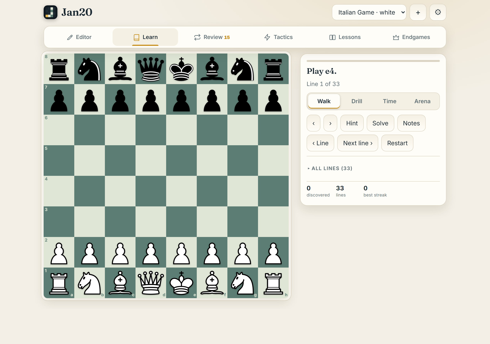
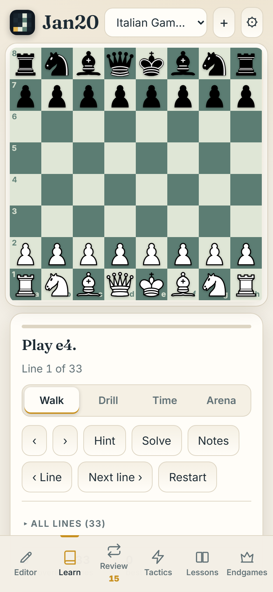

# Jan20

A chess opening trainer that runs entirely on your own device. Write a repertoire, walk and drill it,
review it on a spaced schedule, and train tactics and endgames against a bundled engine. No account,
no sync, no server: after the first load nothing leaves the machine.

Windows desktop app, Android app, or a web/PWA build from the same source.

<table>
<tr>
<td width="62%"></td>
<td width="38%"></td>
</tr>
</table>

```
Editor    build the repertoire: play moves, add notes, branch, reorder, name lines
Learn     walk the lines with commentary, or drill them — a miss restarts the line
Review    FSRS spaced repetition over the positions in your repertoire
Tactics   rated puzzles, a theme filter, and lessons that teach the ideas behind them
Endgames  play out a position to a goal; a move that throws it away is taken back
Arena     play a game from your own line; the opponent follows your book, then plays on
```

## Install

| Platform | How |
|---|---|
| Windows | `Jan20_0.1.0_x64-setup.exe` or the `.msi` from [Releases](../../releases) — Windows 10+ x64 |
| Android | `Jan20_0.1.0.apk` from Releases — Android 7.0+ (minSdk 24) |
| Web / PWA | open the hosted build and use the browser's install button |

The update check in Settings → *Check for updates* reads the newest GitHub release and, on Android,
hands the APK to the system installer.

## Build from source

Node 20+, plus the [Tauri prerequisites](https://tauri.app/start/prerequisites/) for a desktop build
and Android Studio for the phone build.

```sh
npm ci --legacy-peer-deps       # the Capacitor plugins resolve against peer ranges
npm run build                   # web build into dist/
npm run desktop:build           # installers into src-tauri/target/release/bundle
npm run android                 # vite build, cap sync, open Android Studio
```

There is no server component. `dist/` is a static folder: any HTTPS host serves it, and a
service worker precaches the app for offline use.

## Tests

```sh
npm run test:logic        # puzzle, drill, premove, lesson and arrow logic in Node
npm run test:explain      # every explanation the engine layer produces
python3 tools/e2e.py          # browser suites, Playwright + Chromium
python3 tools/e2e-packs.py    # starter packs, line editing, undo
python3 tools/e2e-packs2.py   # tree, notes, reorder, import/export
python3 tools/e2e-modes.py    # Learn, Review, Tactics, Lessons, Endgames
python3 tools/e2e-polish.py   # spacing, dialogs, touch targets, phone layout
```

The browser suites need `pip install playwright && playwright install chromium` and an already served
`dist/` on port 8099. Screenshots are written to the system temp folder and never fail a check.

## Your data

Everything lives on the device in IndexedDB. The desktop build also keeps a JSON file current in the
app config folder, written on every change, so a repertoire is never trapped in the webview; the
browser build can link a file once through the File System Access API and write to it from then on.
A file that cannot be parsed is never overwritten — it is renamed aside first.

Settings → backup writes one JSON file with every repertoire, note and review card, and reads it back
merged or replacing. Lines also export and import as PGN.

## What ships with it

- **8 starter repertoires** — Italian, Evans, Halloween, Alien and Martian Gambits (White); Caro-Kann,
  Sicilian Najdorf and Stafford Gambit (Black). Each is a full tree with notes, added as your own copy.
- **1,245 puzzles** from the [Lichess puzzle database](https://database.lichess.org/#puzzles) (CC0),
  each verified, plus a CSV importer for the full dump.
- **33 lessons** — 22 tactical themes and the endgame chapters, three steps each: the plain idea, the
  way it goes wrong, then a real game.
- **16 endgame drills** — basic mates, king and pawn, Lucena, Philidor, wrong bishop, pawn breakthrough.
- **Stockfish 19 lite** (WASM) in a Web Worker for hints, explanations, gap finding and endgame play.
- Five board palettes, five piece sets, light/dark/system appearance, bundled fonts, synthesised sound.

## Keyboard

`1`–`6` tabs · `/` search the line list · `H` hint · `←`/`→` step through moves · `Backspace` take back
· `Enter`/`Space` next card · `?` shortcuts · `Esc` close a dialog. Starter-pack cards take
`Enter`/`Space` too. Typing moves (`Nf3`) is a setting.

## Licence

GPL-3.0-or-later, because it links Stockfish (GPLv3) and chessground (GPLv3). See `LICENSE`.

Piece artwork comes from the Lichess project under its own licences — see `PIECES-LICENSES.md`.
Fonts: Fraunces and Inter (SIL OFL 1.1). Puzzles: Lichess, CC0.
